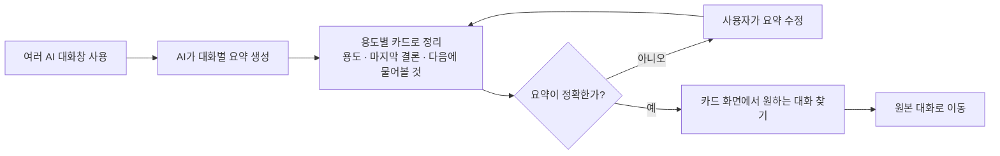

# 🔄 Reflow Service

### 여러 AI 대화를 용도별 카드로 모아 보는 **'대화 지도'**

**시스템과 사용자 경험 · 7조 조별과제**

---

## 📌 목차

1. [프로젝트 소개](#-프로젝트-소개)
2. [핵심 키워드](#-핵심-키워드)
3. [만들게 된 이유](#-만들게-된-이유)
4. [해결 방법](#-해결-방법)
5. [핵심 기능](#-핵심-기능)
6. [서비스 흐름](#-서비스-흐름)
7. [아웃풋](#-아웃풋)
8. [검증 방법](#-검증-방법)
9. [학문적 근거](#-학문적-근거)
10. [기대 효과 및 장점](#-기대-효과-및-장점)

---

## 💡 프로젝트 소개

> **Reflow Service**는 여러 AI 대화창에 흩어진 대화를 **용도별 카드**로 모아,
> 어느 창에서 무슨 이야기를 했는지 한눈에 볼 수 있게 해주는 **'대화 지도'** 서비스입니다.

---

## 🔑 핵심 키워드

| 키워드 | 의미 |
|:---:|---|
| 🧠 **작업기억** | 정보를 잠시 머릿속에 붙잡아 두고 처리하는 기억으로, 한 번에 다룰 수 있는 양이 제한됨 |
| 🧵 **맥락 유지** | 여러 대화를 오가도 각 대화의 흐름과 결론을 잃지 않도록 함 |
| ⚖️ **외재적 인지부하** | 과제 자체가 아니라, 정보가 제시되고 흩어져 있는 방식 때문에 생기는 불필요한 부담 |
| 📤 **인지적 오프로딩** | 기억해야 할 내용을 외부 도구(카드)에 맡겨 머리의 부담을 덜어냄 |

---

## ❗ 만들게 된 이유

### AI 창을 여러 개 쓰다 보면 헷갈린다

- 과제, 업무, 여행 계획을 **각각 다른 AI 창**에서 물어보다 보면 **어느 창에서 무슨 이야기를 했는지 잊게 됨**
- 전에 찾은 답을 **다시 찾거나**, 같은 설명을 **반복**하게 됨

---

## ✅ 해결 방법

- 창마다 **무슨 용도인지 · 마지막 결론 · 다음에 물어볼 것**을 카드로 보여줌
- AI가 요약한 내용을 **내가 확인하고 고칠 수 있으며**, 카드에서 **원래 대화로 돌아갈 수 있게** 함

---

## ✨ 핵심 기능

| 기능 | 설명 |
|:---:|---|
| 🗂 **카드 요약** | 용도, 마지막 결론, 다음에 물어볼 것을 카드로 보여줌 |
| ✏️ **요약 수정** | AI가 만든 요약을 사용자가 직접 확인하고 고칠 수 있음 |
| ↩️ **원본으로 이동** | 카드에서 원래 대화로 바로 돌아갈 수 있음 |

---

## 🔄 서비스 흐름

---

## 🖥 아웃풋

**여러 AI 대화를 한눈에 정리해주는 화면**

- 창이 1개, 3개, 5개일 때 **이전 답을 찾는 시간**과 **잘못된 창에 질문한 횟수**를 비교

---

## 🧪 검증 방법

창 개수별로 **카드 화면**과 **일반 화면**을 비교합니다.

| 조건 | 일반 화면 | 카드 화면 (Reflow) |
|:---:|:---:|:---:|
| 창 1개 | 측정 | 측정 |
| 창 3개 | 측정 | 측정 |
| 창 5개 | 측정 | 측정 |

**측정 지표**

- ⏱ **이전 답을 찾는 시간**
- ❌ **잘못된 창에 질문한 횟수**

---

## 📚 학문적 근거

- **작업기억의 한계**와 **외재적 인지부하 감소**, **인지적 오프로딩**으로 설명
- **이전 답을 찾는 시간**과 **잘못된 창에 질문한 횟수**로 효과를 검증

---

## 🌟 기대 효과 및 장점

| 구분 | 내용 |
|:---:|---|
| 🆕 **신선함** | 여러 AI 대화창 사용이라는 **동시대 문제**를 다룸 |
| 🎯 **구체적 해법** | **카드 요약**과 **원본으로 이동** 기능으로 명확한 해결책 제시 |
| 🧪 **실험 용이성** | 창 개수별 비교 실험 설계가 쉬움 |
| 📈 **시장성** | AI 사용 증가로 대화 관리 수요가 커지는 영역 |
| 💼 **확장 가능성** | 플랫폼 내 기능, 브라우저 확장 프로그램, 구독 모델로 발전 가능 |

---

**시스템과 사용자 경험 · 7조** | Reflow Service

