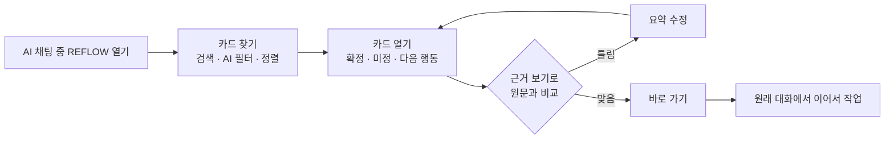

# REFLOW

### 여러 AI 대화를 테마별 카드로 모아 보는 **'대화 작업대'**

**시스템과 사용자 경험 · 7조 조별과제**

---

## 목차

1. [프로젝트 소개](#-프로젝트-소개)
2. [핵심 키워드](#-핵심-키워드)
3. [만들게 된 이유](#-만들게-된-이유)
4. [해결 방법](#-해결-방법)
5. [핵심 기능](#-핵심-기능)
6. [서비스 흐름](#-서비스-흐름)
7. [아웃풋](#-아웃풋)
8. [검증 방법](#-검증-방법)
9. [학문적 근거](#-학문적-근거)
10. [기대 효과 및 장점](#-기대-효과-및-장점)

---

## 프로젝트 소개

> **REFLOW**는 ChatGPT, Claude, Gemini, Perplexity 등 여러 AI에 흩어진 대화를 **테마별 카드**로 모아,
> 어디까지 정했는지 확인하고 하던 대화로 바로 돌아갈 수 있게 해주는 서비스입니다.

---

## 핵심 키워드

| 키워드 | 의미 |
|:---:|---|
| **작업기억** | 정보를 잠시 머릿속에 붙잡아 두고 처리하는 기억으로, 한 번에 다룰 수 있는 양이 제한됨 |
| **맥락 유지** | 여러 대화를 오가도 각 대화의 흐름과 결론을 잃지 않도록 함 |
| **외재적 인지부하** | 과제 자체가 아니라, 정보가 제시되고 흩어져 있는 방식 때문에 생기는 불필요한 부담 |
| **인지적 오프로딩** | 기억해야 할 내용을 외부 도구(카드)에 맡겨 머리의 부담을 덜어냄 |

---

## 만들게 된 이유

### AI 창을 여러 개 쓰다 보면 헷갈린다

- 과제, 업무, 여행 계획을 **각각 다른 AI 창**에서 물어보다 보면 **어느 창에서 무슨 이야기를 했는지 잊게 됨**
- 전에 찾은 답을 **다시 찾거나**, 같은 설명을 **반복**하게 됨

---

## 해결 방법

- 대화마다 **확정 · 미정 · 다음 행동**을 카드로 보여줌
- 요약 옆 **근거 보기**로 원문을 확인하고, 요약이 틀리면 **직접 고칠 수 있음**
- 카드의 **바로 가기**로 원래 대화로 돌아가 이어서 작업함

---

## 핵심 기능

| 기능 | 설명 |
|:---:|---|
| **카드 요약** | 대화마다 확정, 미정, 다음 행동을 카드로 보여줌 |
| **근거 보기** | 요약 각 줄의 근거가 된 원문 메시지를 강조해 보여줌 |
| **요약 수정** | AI 요약을 사용자가 고치면 카드에 '사용자 수정'으로 표시됨 |
| **원본으로 이동** | 바로 가기로 원래 대화 화면을 열어 이어서 작업함 |

### 보조 기능

| 기능 | 설명 |
|:---:|---|
| **찾기** | 검색, AI별 필터, 최신 순·테마 순 정렬 |
| **요약 상태 표시** | 요약 초안 / 확인 필요 / 사용자 수정 |
| **두 가지 보기** | 채팅 화면 위에 여는 패널, 모든 카드를 보는 전체 작업대 |
| **원본 링크 연결** | 수정 화면에서 실제 대화 주소를 붙여 넣어 바로 가기와 연결 |

---

## 서비스 흐름

---

## 아웃풋

**여러 AI 대화를 한눈에 정리해주는 화면**

- 랜딩페이지: `index.html` (서비스 소개 + 프로토타입 바로 가기)
- 시연용 프로토타입: `prototype.html` (채팅 위 패널 + 전체 작업대)
- 창이 1개, 3개, 5개일 때 **이전 답을 찾는 시간**과 **잘못된 창에 질문한 횟수**를 비교

---

## 학문적 근거

- **작업기억의 한계**와 **외재적 인지부하 감소**, **인지적 오프로딩**으로 설명
- **이전 답을 찾는 시간**과 **잘못된 창에 질문한 횟수**로 효과를 검증

---

## 기대 효과 및 장점

| 구분 | 내용 |
|:---:|---|
| **구체적 해법** | **카드 요약**, **근거 보기**, **원본으로 이동**으로 명확한 해결책 제시, 여러 AI 대화창 사용이라는 **동시대 문제**를 다룸 |
| **실험 용이성** | 창 개수별 비교 실험 설계가 쉬움 |
| **시장성** | AI 사용 증가로 대화 관리 수요가 커지는 영역 |
| **확장 가능성** | 플랫폼 내 기능, 브라우저 확장 프로그램, 구독 모델로 발전 가능 |

---

**시스템과 사용자 경험 · 7조** | REFLOW

